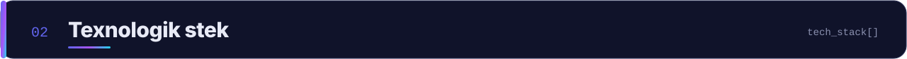
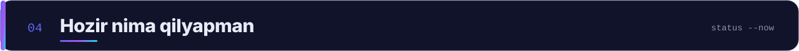
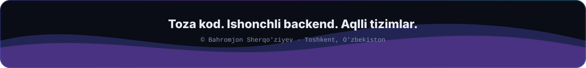

 

&nbsp;

&nbsp;

&nbsp;

 

Men **Python (Django, FastAPI)** ekotizimida xavfsiz, yuqori yuklamalarga chidamli va kengayuvchan backend tizimlar, Telegram platformalari hamda **AI (RAG / LLM)** integratsiyalarini ishlab chiqaman. Dasturlash asoslari va algoritmlarda **Java (Core, OOP, Spring Boot)** bilimlaridan foydalanaman.

 

 

<table>
  <tr>
    <td width="50%"></td>
    <td width="50%"></td>
  </tr>
  <tr>
    <td width="50%"></td>
    <td width="50%"></td>
  </tr>
  <tr>
    <td width="50%"></td>
    <td width="50%"></td>
  </tr>
  <tr>
    <td width="50%"></td>
    <td width="50%"></td>
  </tr>
</table>

 

 

